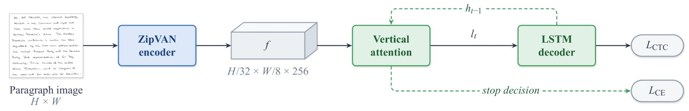
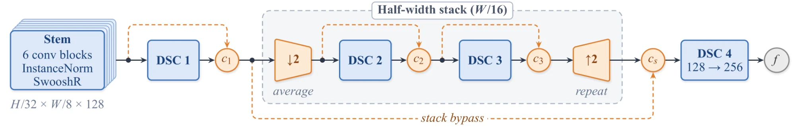
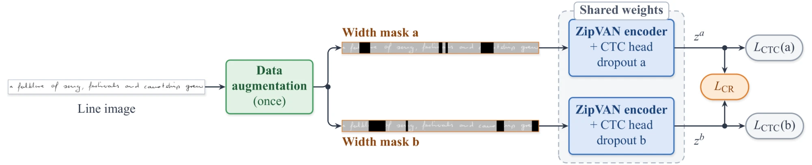

# ZipVAN

Code for the paper "ZipVAN: A Lightweight Handwritten Paragraph Recognition Model Leveraging ASR-Inspired Techniques".

ZipVAN is the Vertical Attention Network (VAN) of Coquenet et al. with three components of the Zipformer speech encoder added to its encoder: Swoosh activations with learnable bypasses, downsampling along the reading axis inside the encoder stack, and BiasNorm. It is trained with ScaledAdam and the Eden schedule, and its encoder is pretrained on text lines with consistency-regularized CTC (CR-CTC), using two views of each line that differ only in dropout and width masks. The paragraph model has 2,720,060 parameters, 1,156 more than VAN.

This repository starts from the official VAN code: https://github.com/FactoDeepLearning/VerticalAttentionOCR. The Swoosh activations, BiasNorm, ScaledAdam and Eden are taken from the Zipformer code in [icefall](https://github.com/k2-fsa/icefall). The CR-CTC loss and the width masks are implemented here from the CR-CTC paper, in `OCR/line_OCR/ctc/trainer_line_ctc.py`.





Green: unchanged from VAN; blue: changed; orange: new in ZipVAN; gray: feature map and losses.

## Results

IAM test set, greedy CTC decoding, no language model or lexicon.

| Model | Line CER (%) | Line WER (%) | Paragraph CER (%) | Paragraph WER (%) |
|---|---|---|---|---|
| VAN, as reported | 5.01 | 16.49 | 4.45 | 14.55 |
| ZipVAN | 4.54 | 14.86 | 4.20 | 13.59 |

ZipVAN numbers are the mean of three seeds. The paragraph model is trained for 1,000 epochs.

## Requirements

```
pip install -r requirements.txt
```

The results were obtained with PyTorch 2.12 on a single RTX 4090.

## Dataset

Only IAM is used, with the split of VAN: 6,482 / 976 / 2,915 lines and 747 / 116 / 336 paragraphs for training, validation and test.

1. Register at the [FKI webpage](https://fki.tic.heia-fr.ch/databases/iam-handwriting-database) and download the dataset.
2. Put `formsA-D.tgz`, `formsE-H.tgz`, `formsI-Z.tgz`, `lines.tgz` and `ascii.tgz` in `Datasets/raw/IAM/`.
3. In the main block of `Datasets/format_datasets.py`, keep `format_IAM_line()` and uncomment `format_IAM_paragraph()`, then run it from `Datasets/`:

```
cd Datasets
python3 format_datasets.py
```

This writes `Datasets/formatted/IAM_lines` and `Datasets/formatted/IAM_paragraph`.

## Training

All configurations are presets in `basic/presets.py`. The line-level presets correspond to the rows of Table II of the paper:

| Preset | Row |
|---|---|
| `van` | VAN, our run (official configuration, 5,000 epochs) |
| `L1` | ScaledAdam + Eden (500 epochs) |
| `L2` | + Swoosh, bypasses |
| `L3` | + width downsampling |
| `L4` | + BiasNorm |
| `L4_no_ds` | w/o width downsampling |
| `L6_masks_only` | + width masks, no consistency term |
| `L5` | + CR-CTC, dropout views |
| `L6` | + width masks (ZipVAN) |
| `L4_double` | CTC at the cost of CR-CTC: twice the batch size and twice the epochs |
| `L6_half` | CR-CTC at the cost of CTC: half the batch size and half the epochs |

### Line level



The augmentation is applied once; the two views differ only in their width masks (black strips) and in the dropout sampled in the encoder, whose weights are shared.

```
cd OCR/line_OCR/ctc
python3 main_line_ctc.py --preset L6 --seed 1111
```

The output goes to `outputs/L6_seed1111` (`outputs/fcn_iam_line` for the `van` preset, which uses seed 2222).

### Paragraph level

A paragraph model starts from the best checkpoint of a line run:

```
cd OCR/document_OCR/v_attention
python3 main_pg_va.py --preset zipvan --line_preset L6 --seed 1111
```

This reads `../../line_OCR/ctc/outputs/L6_seed1111/checkpoints/best_*.pt` and writes `outputs/P_L6_seed1111`. Use `--line_folder` to start from another line run. Running `python3 main_pg_va.py` without arguments trains VAN from `fcn_iam_line`.

The final model is the 500-epoch paragraph run continued to 1,000 epochs:

```
cp -r outputs/P_L6_seed1111 outputs/P_L6_1000_seed1111
python3 main_pg_va.py --preset zipvan --line_preset L6 --seed 1111 --output_folder P_L6_1000_seed1111 --max_epochs 1000 --resume
```

## Evaluation

`--eval_only` evaluates the best checkpoint of the output folder on the training, validation and test sets and writes `predict_*.txt` to its `results` folder. At line level, `--peakiness` writes the CTC output statistics of Table IV.

```
cd OCR/document_OCR/v_attention
python3 main_pg_va.py --preset zipvan --line_preset L6 --output_folder P_L6_1000_seed1111 --eval_only
```

## Trained models

The checkpoints of the final models are in [release v1.0](https://github.com/Sadeghi-Sara/ZipVAN/releases/tag/v1.0): the three line models (`L6`) and the three paragraph models (`P_L6_1000`), with the `params` file of each paragraph run. Put a checkpoint in the `checkpoints` folder of its run and keep `best` in its file name, for example:

```
OCR/line_OCR/ctc/outputs/L6_seed1111/checkpoints/best_452.pt
OCR/document_OCR/v_attention/outputs/P_L6_1000_seed1111/checkpoints/best_790.pt
```

## License

The code is based on VAN and is under the CeCILL-C license (`LICENSE_CeCILL-C.md`). `basic/scaled_optimizer.py` and `basic/scaling.py` are modified from [icefall](https://github.com/k2-fsa/icefall) and remain under the Apache License 2.0 (`LICENSE_Apache-2.0.txt`).

## Citation

If you use this code, please cite VAN:

```bibtex
@ARTICLE{Coquenet2023a,
    author={Coquenet, Denis and Chatelain, Clement and Paquet, Thierry},
    journal={IEEE Transactions on Pattern Analysis and Machine Intelligence},
    title={End-to-end Handwritten Paragraph Text Recognition Using a Vertical Attention Network},
    year={2023},
    volume={45},
    number={1},
    pages={508-524},
    doi={10.1109/TPAMI.2022.3144899}
}
```
